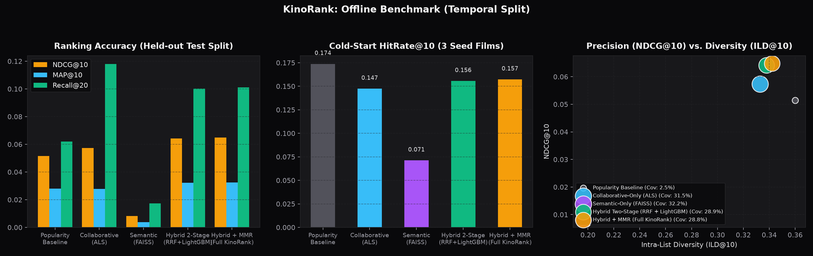
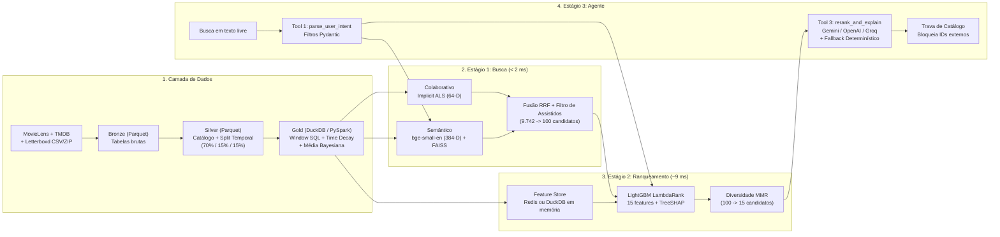

# KinoRank

[](https://github.com/Lealwbs/kinorank/actions)
[](https://www.python.org/)
[](https://duckdb.org/)
[](https://lightgbm.readthedocs.io/)
[](https://huggingface.co/spaces/Lealwbs/kinorank)

Aplicação em Python que une Machine Learning clássico (ALS + FAISS + LightGBM) e um agente LLM para recomendar filmes reais do catálogo a partir do seu histórico (como o arquivo exportado do Letterboxd) ou de pedidos em texto livre.

> O foco deste projeto não é só "chamar uma LLM": é a engenharia de dados e o funil de Machine Learning antes dela para cortar o custo de tokens em mais de 600 vezes, responder em milissegundos e garantir 0% de filmes inventados.

*(Os slides da apresentação de 5 minutos deste projeto estão em [`docs/apresentacao_kinorank.pdf`](docs/apresentacao_kinorank.pdf)).*

## Contexto

Sexta à noite: o pedido do iFood chega, você abre o streaming para escolher um filme rápido e passa 45 minutos rolando a tela até a comida esfriar. Isso acontece por dois motivos práticos:
1. **A vitrine padrão repete sempre os mesmos famosos:** rankings de popularidade concentram as sugestões em apenas **2,5%** do catálogo.
2. **Pedir dica solta para o ChatGPT falha no catálogo real:** se você pede *"quero um suspense psicológico estilo Fincher, com menos de 2h, depois de 1994 e sem terror"*, um LLM puro sugere filme de 3 horas, indica títulos que você já assistiu ou inventa filmes que não existem.

## Gargalo

Por que não dá para resolver isso filtrando na mão nem jogando o catálogo inteiro no prompt do LLM? Na nossa base real (MovieLens + TMDB) existem **9.742 filmes** e **100.836 avaliações**:

- **Gargalo humano:** ler sinopse, checar diretor, duração e cruzar com o que você já viu no Letterboxd leva cerca de **30 segundos por filme**. Avaliar apenas 100 opções na mão consome `100 * 30s = 3.000s` (**50 minutos**). Olhar o catálogo inteiro levaria **81 horas**.
- **Gargalo de jogar tudo no LLM:** cada filme com título, ano, gêneros, diretor, tags e sinopse ocupa cerca de **120 tokens**. Enviar os 9.742 filmes no prompt a cada busca exigiria **1,17 milhão de tokens por clique**:
  - Tempo de espera na tela: **~45 segundos** por busca.
  - Custo para apenas 1.000 buscas: `1.000 * 1,17M = 1,17 bilhão de tokens` $\approx$ **\$175,50 USD (~R\$ 1.018)**.

A solução deste projeto é um **funil em 3 estágios**: o Estágio 1 peneira de 9.742 para 100 filmes em `< 2 ms`, o Estágio 2 ranqueia e diversifica os 15 melhores em `~9 ms`, e o Agente LLM atua apenas nos 15 finalistas com uma trava rígida de IDs.

## Resultados

| 9.742 | 100.836 | 610 | 11,26 ms |
|:---:|:---:|:---:|:---:|
| filmes no catálogo | avaliações (MovieLens) | usuários avaliados | latência mediana (p50) |

| +25,8% | 28,84% vs 2,50% | 0% |
|:---:|:---:|:---:|
| ganho de NDCG@10 sobre popularidade | cobertura ativa do catálogo (11,5x maior) | filmes alucinados ou já assistidos |

Comparativo offline nos **604 usuários do conjunto de teste temporal** (treino nos primeiros 70% cronológicos de cada usuário, validação em 15% e teste nos 15% finais):

| Modelo | NDCG@10 | Recall@20 | MAP@10 | Cobertura (%) | Cold-Start HR@10 | Diversidade (ILD@10) | p50 (ms) | p95 (ms) |
| :--- | :---: | :---: | :---: | :---: | :---: | :---: | :---: | :---: |
| **Popularity Baseline** | `0.0515` | `0.0620` | `0.0280` | `2.50%` | `0.1738` | `0.3599` | `0.01` | `0.02` |
| **Collaborative-Only (ALS)** | `0.0574` | `0.1181` | `0.0277` | `31.48%` | `0.1474` | `0.3328` | `0.19` | `0.60` |
| **Semantic-Only (FAISS)** | `0.0082` | `0.0173` | `0.0038` | `32.17%` | `0.0712` | `0.1967` | `0.89` | `1.26` |
| **Hybrid Two-Stage (RRF + LightGBM)** | `0.0642` | `0.1002` | `0.0323` | `28.94%` | `0.1556` | `0.3379` | `6.35` | `8.47` |
| **Hybrid + MMR (Full KinoRank)** | **`0.0648`** | `0.1012` | **`0.0325`** | `28.84%` | `0.1573` | **`0.3421`** | `12.16` | `14.93` |



- **O que funcionou:** combinar ALS e FAISS via RRF e reordenar com LightGBM (`lambdarank`) superou o modelo colaborativo isolado em **+12,9% no NDCG@10** e **+17,3% no MAP@10**. O pós-processamento com MMR ($\lambda = 0{,}75$) aumentou a diversidade sem perder precisão no topo.
- **O que não funcionou sozinho:** a busca semântica pura (`FAISS` isolado) teve `NDCG@10 = 0.0082`. Encontrar uma sinopse parecida não garante uma boa recomendação se o sistema não cruzar isso com a qualidade avaliada por outros usuários.

## Pipeline

```text
MovieLens + TMDB + Letterboxd -> Parquet (Bronze / Silver / Gold)
                              -> Estagio 1: ALS + FAISS -> Fusao RRF (Top 100 em < 2 ms)
                              -> Estagio 2: LightGBM LambdaRank + MMR (Top 15 em ~9 ms)
                              -> Estagio 3: Agente LLM + Trava de Catalogo (Top 10)
```



## Estágios

### Dados
Organização dos dados em três camadas Parquet (`bronze`, `silver`, `gold`) usando DuckDB ([`src/data/features_duckdb.py`](src/data/features_duckdb.py)) e versão espelhada em PySpark ([`src/data/features_pyspark.py`](src/data/features_pyspark.py)):
- **Corte cronológico por usuário (Zero Data Leakage):** se dividirmos os dados por sorteio aleatório, o modelo usa notas que a pessoa deu em 2024 para "adivinhar" o que ela assistiu em 2022. Aqui ordenamos a linha do tempo de cada usuário por `timestamp` (`70% passado / 15% validação / 15% futuro`) e testamos matematicamente que nenhum dado futuro vaza para o treino.
- **Média bayesiana:** evita que um filme com apenas 1 avaliação nota 5.0 fique acima de um clássico com 300 avaliações nota 4.8 ($m = 15$ votos de peso prévio).
- **Decaimento no tempo:** dá peso maior ($\exp(-\lambda \Delta t)$) aos gêneros e diretores que o usuário curtiu recentemente.

### Busca
Reduz o catálogo de 9.742 filmes para 100 candidatos inéditos ([`src/retrieval/hybrid.py`](src/retrieval/hybrid.py)):
- **Gosto parecido (ALS em [`src/retrieval/collaborative.py`](src/retrieval/collaborative.py)):** fatora a matriz de interações em 64 dimensões. Quando um usuário novo sobe seu arquivo do Letterboxd ou escolhe 3 filmes no Cold-Start, calculamos o vetor dele na hora pela média dos filmes escolhidos.
- **Conteúdo parecido (FAISS em [`src/retrieval/semantic.py`](src/retrieval/semantic.py)):** transforma título, ano, gêneros, diretor, tags e sinopse em vetores de 384 dimensões (`BAAI/bge-small-en-v1.5`) para busca rápida por similaridade.
- **Fusão por posição (RRF):** soma o inverso das posições das duas listas, sem precisar calibrar escalas diferentes entre o ALS e o FAISS:

$$\text{RRF}(i) = \frac{w_{\text{als}}}{60 + \text{pos}_{\text{als}}(i)} + \frac{w_{\text{faiss}}}{60 + \text{pos}_{\text{faiss}}(i)}$$

### Ranqueamento
Um modelo `LightGBM` (`objective="lambdarank"`) avalia os 100 candidatos cruzando 15 variáveis de afinidade ([`src/ranking/lgbm_ranker.py`](src/ranking/lgbm_ranker.py)):
- Pontuações do Estágio 1 (`rrf_score`, `collab_score`, `semantic_score` e posições).
- Afinidade do usuário com os gêneros, a década e o diretor daquele filme.
- Coocorrência item-item com os últimos favoritos do usuário, nota bayesiana e popularidade recente.
- Extrai o peso exato de cada variável na decisão via **TreeSHAP** (`pred_contrib=True`) e aplica **MMR** ([`src/ranking/diversity.py`](src/ranking/diversity.py)) para não recomendar 5 continuações da mesma franquia na mesma lista.

### Agente
Orquestração em 3 tools validadas com Pydantic ([`src/agent/tools.py`](src/agent/tools.py)):
1. `parse_user_intent`: transforma pedidos em linguagem natural em filtros estruturados (gêneros obrigatórios, gêneros proibidos, duração máxima, ano mínimo e diretor de referência).
2. `retrieve_and_rank`: roda os Estágios 1 e 2 aplicando os filtros rígidos.
3. `rerank_and_explain`: reordena os 15 finalistas e escreve uma explicação curta citando os filmes reais que a pessoa já avaliou bem.
- **Trava contra alucinação ([`src/agent/guardrails.py`](src/agent/guardrails.py)):** se o LLM tentar devolver qualquer `movie_id` fora dos 15 finalistas ou um filme que o usuário já assistiu, a trava descarta o item na hora. Se a API externa atrasar ou estiver sem chave, o fallback determinístico responde em `< 1 ms`.

## Execução

### Local

```bash
# Ver todos os comandos disponiveis
make help

# 1. Instalar dependencias, processar dados, treinar modelos e rodar benchmark
make setup && make pipeline

# 2. Rodar os 22 testes automatizados e o linter
make test && make lint

# 3. Subir a interface web (http://localhost:7860) ou a API FastAPI (http://localhost:8000/docs)
make ui
# ou: make api
```

### Docker

```bash
cp .env.example .env
make docker-up
```

## Decisões

Conexão direta entre cada escolha deste repositório e um sistema real de recomendação em marketplace (como sugerir restaurantes e pratos no iFood):

| Decisão no KinoRank | Problema que resolve | Paralelo direto no iFood |
| :--- | :--- | :--- |
| **Funil `9.742 -> 100 -> 15 -> 10`** | Rodar 15 features + LLM nos 9.742 filmes custaria R\$ 1.018 a cada mil buscas e 45s de espera. O funil responde em `11 ms` gastando 600x menos tokens. | Na home do app, o Estágio 1 filtra restaurantes abertos no raio de entrega, o Estágio 2 ordena por conversão e tempo de entrega, e o Estágio 3 atua só nos cards do topo. |
| **Busca Híbrida (ALS + FAISS via RRF)** | O colaborativo acerta o hábito mas não entende texto livre; a busca semântica entende o pedido mas tem NDCG baixo sozinha (`0.0082`). | Atende tanto quem pede o mesmo prato toda terça-feira (hábito colaborativo) quanto quem digita *"almoço saudável até 35 reais entregue em 30 min"*. |
| **Feature Store Dual (Redis + Memória)** | Em produção com Docker usa Redis em baixa latência; no Hugging Face Spaces ou nos testes roda direto da camada Gold em memória sem quebrar. | Desacopla o cálculo pesado de features históricas (Spark/DuckDB) da leitura rápida online na hora do clique. |
| **Diversidade com MMR ($\lambda = 0{,}75$)** | Evita que a lista final mostre 5 filmes quase iguais da mesma franquia, subindo a diversidade (`ILD@10 = 0.3421`) e o `NDCG@10` (`0.0648`). | Evita mostrar 10 hambúrgueres idênticos seguidos na vitrine, aumentando a descoberta de categorias variadas. |
| **Trava de IDs + Fallback Determinístico** | Impede que o LLM invente filmes fora do catálogo, recomende o que o usuário já viu ou derrube a requisição em caso de erro `429`/timeout. | Garante que nenhum prato esgotado ou restaurante fechado apareça para o cliente mesmo se a API de IA oscilar. |

## Roteiro

Resumo prático para apresentar o projeto em 5 minutos (seguindo os 6 slides de [`docs/apresentacao_kinorank.pdf`](docs/apresentacao_kinorank.pdf)):

1. **Contexto (Slide 0):** sexta à noite a comida chega e você gasta 45 minutos tentando escolher um filme porque os rankings padrões mostram só 2,5% do catálogo e o ChatGPT puro indica filme repetido ou que não existe.
2. **Conta de escala (Slide 1.1):** avaliar 100 filmes na mão a 30s por filme leva 50 minutos. E jogar os 9.742 filmes direto no prompt do LLM consome 1,17 milhão de tokens por clique (~45s de espera e mais de R\$ 1.000 a cada mil buscas).
3. **Arquitetura e protagonismo (Slide 2):** construí o funil em 3 estágios (ALS + FAISS com RRF $\rightarrow$ LightGBM LambdaRank com 15 features e MMR $\rightarrow$ Agente LLM só no Top 15). Corrigi dois erros clássicos: eliminei *data leakage* com split cronológico por usuário e criei o `guardrails.py` para bloquear qualquer ID alucinado ou já assistido.
4. **Resultados e aprendizados (Slide 3):** nos 604 usuários de teste, ampliamos a cobertura de catálogo em **11,5x (`28,84%`)**, subimos o **NDCG@10 em +25,8% (`0,0648`)** em **11,26 ms (p50)** com **0% de alucinação**. Aprendizado central: busca semântica isolada falha (`0,0082`) sem o sinal colaborativo no LightGBM. Próximo passo natural: rede Two-Tower com contexto de horário (café às 8h vs jantar às 20h).

## Estrutura

```text
kinorank/
├── .github/workflows/ci.yml                # Pipeline CI (Ruff + Pytest)
├── .pre-commit-config.yaml                 # Hooks de formatacao e lint
├── artifacts/metrics/                      # Tabelas JSON/MD e grafico do benchmark
├── docs/apresentacao_kinorank.pdf          # Slides da apresentacao de 5 minutos
├── notebooks/kaggle_recsys_benchmark.ipynb # Notebook executavel com EDA, SQL e benchmark
├── scripts/
│   ├── run_pipeline.py                     # Orquestrador de dados e treino
│   ├── publish_hf.py                       # Publicacao no Hugging Face (Model, Dataset e Space)
│   └── publish_kaggle.py                   # Publicacao no Kaggle
├── src/
│   ├── config.py                           # Configuracoes centralizadas (.env)
│   ├── schemas/                            # Contratos Pydantic (Dominio, Agente, API)
│   ├── data/                               # Ingestao, TMDB, Split, DuckDB, PySpark, Letterboxd
│   ├── retrieval/                          # Estagio 1: ALS, FAISS e RRF
│   ├── ranking/                            # Estagio 2: Feature Store, LightGBM e MMR
│   ├── agent/                              # Estagio 3: Cliente LLM, Tools, Guardrails, Telemetria
│   ├── evaluation/                         # Metricas (NDCG, Recall, MAP, Cobertura, ILD) e Benchmark
│   └── api/main.py                         # API FastAPI
├── tests/                                  # 22 testes automatizados (dados reais, zero mocks)
├── ui/
│   ├── gradio_app.py                       # Interface Gradio
│   └── static_space.py                     # Gerador do Space estatico interativo
├── app.py                                  # Entrypoint raiz
├── Dockerfile                              # Build multi-stage
├── docker-compose.yml                      # FastAPI + Redis + UI
└── Makefile                                # Atalhos com menu interativo (make help)
```
